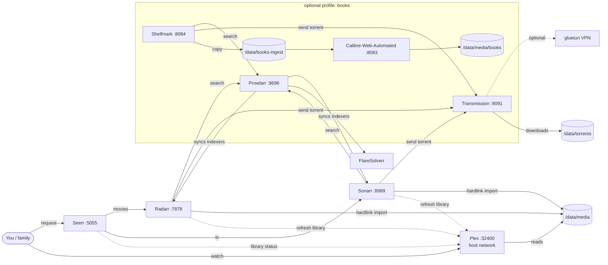

# media-stack

A self-hosted media server and automation stack in **one Docker Compose project, on one machine, with local disks**. You don't need a NAS.

| Service | What it does | Port |
|---|---|---|
| [Plex Media Server](https://www.plex.tv/) | Streams your library to TVs, phones and browsers | 32400 (host network) |
| [Seerr](https://github.com/seerr-team/seerr) | Request UI: family and friends ask for movies and shows here | 5055 |
| [Radarr](https://radarr.video/) | Movie library manager: finds, grabs, renames and imports | 7878 |
| [Sonarr](https://sonarr.tv/) | The same for TV series | 8989 |
| [Prowlarr](https://prowlarr.com/) | Indexer manager that pushes indexers to Radarr, Sonarr and Shelfmark | 9696 |
| [FlareSolverr](https://github.com/FlareSolverr/FlareSolverr) | Solves Cloudflare challenges for Prowlarr (internal only) | – |
| [Transmission](https://transmissionbt.com/) | BitTorrent client | 9091, 51413 |
| **Optional:** [Unpackerr](https://github.com/Unpackerr/unpackerr) | Extracts RAR'd releases so Radarr and Sonarr can import them | – |
| **Optional:** [Calibre-Web-Automated](https://github.com/crocodilestick/Calibre-Web-Automated) | Ebook library and reader, with automatic ingest | 8083 |
| **Optional:** [Shelfmark Lite](https://github.com/calibrain/shelfmark) | Book search and request UI, like Seerr but for books | 8084 |
| **Optional:** [gluetun](https://github.com/qdm12/gluetun) | VPN tunnel with a kill switch for Transmission | – |

The optional parts are **off by default**. They're enabled with [Compose profiles](https://docs.docker.com/compose/how-tos/profiles/) (`books`, `unpackerr`) and override files (`compose.vpn.yml`, `compose.nvidia.yml`).

> **Legal note:** This project is a set of tools. Only download, store and share media you own or have the right to use, and follow the laws of your country and the terms of any service you connect. This repo ships **no** indexer or tracker configuration.

---

## Contents

1. [Architecture](#architecture)
2. [Prerequisites](#prerequisites)
3. [Install Docker and Compose](#install-docker-and-compose)
4. [Disk layout (the most important part)](#disk-layout-the-most-important-part)
5. [Get the repo and configure `.env`](#get-the-repo-and-configure-env)
6. [Create folders and set permissions](#create-folders-and-set-permissions)
7. [First boot](#first-boot)
8. [First-run wiring, app by app](#first-run-wiring-app-by-app)
9. [Hardware transcoding](#hardware-transcoding)
10. [Remote access](#remote-access)
11. [Backups](#backups)
12. [Updating](#updating)
13. [Troubleshooting](#troubleshooting)
14. [Security notes](#security-notes)
15. [Repository layout](#repository-layout)

---

## Architecture



**How a request flows:**
1. Someone requests a movie in Seerr.
2. Seerr passes it to Radarr.
3. Radarr asks Prowlarr's indexers for releases, picks the best match for its quality profile and sends it to Transmission.
4. Transmission downloads into `/data/torrents/movies`.
5. Radarr **hardlinks** the finished file into `/data/media/movies/Title (Year)/`, renames it and tells Plex to refresh.
6. The torrent keeps seeding from the original path while Plex plays the hardlink. It's one copy on disk.

**Why Plex is in the same compose file:** in many home setups Plex runs on a separate box (a NAS, a VM, or an LXC with a passed-through GPU). This repo assumes one machine, so Plex runs here too. It uses **host networking**, which makes LAN discovery, DLNA and Plex's remote-access port mapping work with no extra setup. The other containers reach Plex at `host.docker.internal:32400`, which is mapped in the compose file.

---

## Prerequisites

### Hardware

| | Minimum | Recommended |
|---|---|---|
| CPU | Any 64-bit x86 CPU from the last ~8 years | Intel CPU with **Quick Sync** (for example N100/N150, i3/i5 8th gen+) or an **Intel Arc A310/A380** card, for hardware transcoding |
| RAM | 4 GB | 8–16 GB |
| OS / config disk | 64 GB SSD | 256 GB+ SSD. Plex metadata and thumbnails grow to tens of GB on large libraries |
| Media disk(s) | One HDD | One or more large HDDs. See [Disk layout](#disk-layout-the-most-important-part) |
| Network | Wired gigabit | Wired gigabit |

A Raspberry Pi 5 or other ARM64 board can run every image here, but Plex can't hardware-transcode on it. It's fine when all your clients direct-play.

### Operating system

Any modern 64-bit Linux works. These instructions assume **Ubuntu Server 24.04 LTS** or **Debian 12/13**. You also need:

- a user with `sudo` rights (don't run the stack as root; see [PUID/PGID](#create-folders-and-set-permissions));
- a **static IP or DHCP reservation** for the server, set on your router;
- the correct time zone (`timedatectl set-timezone Europe/Berlin`, for example).

Windows (Docker Desktop/WSL2) and macOS aren't recommended. Hardlinks, permissions and GPU passthrough all behave differently there.

---

## Install Docker and Compose

Use Docker's official repository. Distro packages such as `docker.io` are often too old.

```bash
# Official convenience script (Ubuntu/Debian). Read it first if you like: https://get.docker.com
curl -fsSL https://get.docker.com -o get-docker.sh
sudo sh get-docker.sh

# Let your user run docker without sudo (log out and back in afterwards)
sudo usermod -aG docker "$USER"

# Verify
docker --version
docker compose version     # must be v2.24 or newer (the VPN override uses !reset)
```

If you'd rather install manually, follow <https://docs.docker.com/engine/install/>.

Docker should start at boot. The convenience script enables it, but you can check with `systemctl is-enabled docker`.

---

## Disk layout (the most important part)

### Why a single `/data` tree

This repo uses the layout from the [TRaSH Guides](https://trash-guides.info/File-and-Folder-Structure/). **Downloads and the library live under one parent folder, on one filesystem, and every container sees it at the same path (`/data`).**

```
/data
├── torrents
│   ├── movies        ← Transmission category for Radarr
│   ├── tv            ← Transmission category for Sonarr
│   ├── books         ← Shelfmark (books profile)
│   └── incomplete    ← in-progress downloads
├── media
│   ├── movies        ← Radarr root folder  → Plex "Movies" library
│   ├── tv            ← Sonarr root folder  → Plex "TV Shows" library
│   └── books         ← Calibre library     (books profile)
└── books-ingest      ← Calibre-Web-Automated watch folder (books profile)
```

This gives you three things:

- **Hardlinks.** Radarr and Sonarr "copy" a finished download into the library as a hardlink: a second name for the same data on disk. It's instant, uses no extra space, and the torrent keeps seeding. This only works when the source and destination are **on the same filesystem** *and* **visible to the container through the same mount**. Two separate mounts such as `/downloads` and `/movies` look like different filesystems to the app, even when they're on the same disk. Then every import becomes a slow full copy and uses double the space.
- **Atomic moves.** When a hardlink isn't possible (for example, you've turned seeding off), a move within one filesystem is an instant rename, not copy-then-delete.
- **No remote path mappings.** Transmission reports `/data/torrents/movies/…` and Radarr sees exactly that path, so you never need Radarr's "Remote Path Mappings".

Don't use `/data` for anything else, and don't point containers at sub-folders under different names.

### Filesystem choice

Use **ext4** or **XFS**. **Btrfs** and **ZFS** are also fine. Avoid NTFS and exFAT: exFAT has no hardlinks, and permissions on both are unreliable on Linux.

### Option A: single data disk (simplest)

```bash
# Identify the disk. Be sure you pick the right one; formatting erases it.
lsblk -o NAME,SIZE,MODEL,SERIAL,MOUNTPOINT

# Partition + format (example: /dev/sdb; this ERASES it)
sudo parted /dev/sdb --script mklabel gpt mkpart data ext4 0% 100%
sudo mkfs.ext4 -L data /dev/sdb1

# Mount it permanently at /data
sudo mkdir -p /data
echo "UUID=$(sudo blkid -s UUID -o value /dev/sdb1)  /data  ext4  defaults,noatime  0 2" | sudo tee -a /etc/fstab
sudo systemctl daemon-reload
sudo mount -a && df -h /data
```

You can also just use a folder on the OS disk (`DATA_ROOT=/data` on the root filesystem) to try things out.

### Option B: several disks

There are three common ways to pool several disks:

| Approach | Pros | Cons |
|---|---|---|
| **One disk per mount, no pooling** | Simplest | Hardlinks only work *within* one disk, so each disk needs its own `torrents/` + `media/` tree and its own Radarr/Sonarr root folder. Gets messy fast. Not recommended. |
| **mergerfs** (+ optional **SnapRAID** for parity) | Mix disks of any size, add disks one at a time, a dead disk loses only its own files | A FUSE layer. Hardlinks work only when both paths sit on the same underlying disk (see below). |
| **ZFS / Btrfs RAID / LVM** | One real filesystem, so hardlinks always work. ZFS/Btrfs add checksums, snapshots and redundancy | Less flexible to grow with odd-sized disks. ZFS needs RAM and some learning. |

**mergerfs example** (optional). Mount each disk separately, then pool them at `/data`:

```bash
sudo apt install mergerfs
sudo mkdir -p /mnt/disk1 /mnt/disk2 /data
# /etc/fstab: one line per disk, then the pool
UUID=<disk1-uuid>  /mnt/disk1  ext4  defaults,noatime  0 2
UUID=<disk2-uuid>  /mnt/disk2  ext4  defaults,noatime  0 2
/mnt/disk*  /data  fuse.mergerfs  cache.files=off,category.create=mfs,moveonenospc=true,dropcacheonclose=true,minfreespace=50G,fsname=mergerfs  0 0
```

mergerfs and hardlinks: a hardlink is always created on the disk that holds the source file. Use a **non path-preserving create policy** such as `mfs` (most free space) or `ff`, so mergerfs can create the missing destination folders on that same disk. With path-preserving policies (`epmfs`, `epff`, …) a hardlink fails with "cross-device link" when the destination folder only exists on another disk, and Radarr/Sonarr fall back to a full copy. Check the [mergerfs docs](https://trapexit.github.io/mergerfs/) for your version. If you use SnapRAID, follow its guide for parity disks. Also set `CWA_NETWORK_SHARE_MODE=true` if you use the books profile, because Calibre's SQLite database and file watchers behave better that way on FUSE.

Also make sure Docker waits for the pool at boot, or containers may start against an empty mount point:

```bash
sudo systemctl edit docker.service
# add:
[Unit]
RequiresMountsFor=/data
```

---

## Get the repo and configure `.env`

```bash
git clone https://github.com/icepuente/media-stack.git
cd media-stack
cp .env.example .env
chmod 600 .env
nano .env
```

Key settings:

| Variable | What to put there |
|---|---|
| `PUID` / `PGID` | The numeric user/group that should own all files. Run `id` as your normal user; usually `1000`/`1000`. |
| `TZ` | Your [time zone](https://en.wikipedia.org/wiki/List_of_tz_database_time_zones), e.g. `Europe/Berlin`, `America/New_York`. |
| `DATA_ROOT` | The mount point from the previous section, e.g. `/data`. |
| `CONFIG_ROOT` | Where app databases live. The default `./config` (inside the repo, git-ignored) is fine on an SSD. |
| `TRANSCODE_DIR` | Plex's transcoder scratch folder. See [Hardware transcoding](#hardware-transcoding) for the RAM-disk option. |
| `BIND_IP` | Address the web UIs listen on. `0.0.0.0` = all interfaces. See [Security notes](#security-notes). |
| `PLEX_CLAIM` | Leave empty until first boot (it expires after 4 minutes). |
| `TRANSMISSION_USER` / `TRANSMISSION_PASS` | Set these. Otherwise anyone on your network can control the torrent client. |
| `COMPOSE_PROFILES` | `books`, `unpackerr` or `books,unpackerr` to enable optional services. |
| `COMPOSE_FILE` | Add `compose.vpn.yml` and/or `compose.nvidia.yml`. |
| `*_API_KEY` | Fill in after first boot (see below). |

---

## Create folders and set permissions

Every container runs as `PUID:PGID`, not as root. **The folders must be owned by that user**, or you'll get "access denied" and failed imports.

```bash
sudo ./scripts/setup-dirs.sh --dry-run   # preview
sudo ./scripts/setup-dirs.sh
```

This creates the tree shown above plus one config folder per app. It `chown`s them to `PUID:PGID` and sets `2775` (group-writable, setgid) on the data folders.

If you already have media, move it into `/data/media/movies` and `/data/media/tv` **on the same filesystem**. Then fix ownership once:

```bash
sudo chown -R 1000:1000 /data/media      # use your PUID:PGID
sudo chmod -R u=rwX,g=rwX,o=rX /data/media
```

---

## First boot

```bash
# 1. Get a claim token at https://www.plex.tv/claim (signed in), paste it into .env as PLEX_CLAIM=claim-xxxx
#    You have 4 minutes, so do this right before step 3.

# 2. Pull images
docker compose pull

# 3. Start
docker compose up -d

# 4. Watch it come up (Ctrl+C to stop watching)
docker compose ps
docker compose logs -f --tail=50
```

Wait until `docker compose ps` shows the services as `healthy`, which takes about 1–2 minutes. Then **clear `PLEX_CLAIM` in `.env`**; it's only needed once.

Enable the optional parts:

```bash
docker compose --profile books up -d          # one-off
# or permanently: COMPOSE_PROFILES=books,unpackerr in .env, then
docker compose up -d
```

The web UIs are at `http://<server-ip>:<port>`. Replace `<server-ip>` with your server's LAN address; `hostname -I` shows it.

---

## First-run wiring, app by app

Do these in order. Throughout, containers talk to each other **by service name** on the internal Docker network (`http://radarr:7878`, `http://transmission:9091`, …). Don't use your LAN IP, except to reach Plex, which is on the host network: use `host.docker.internal`.

> **API keys:** each *arr app shows its API key under **Settings → General → Security**.

### 1. Plex (`http://<server-ip>:32400/web`)

1. **Claim the server.** If you set `PLEX_CLAIM` before first boot, the server is already linked to your account; sign in and it appears. If you missed the 4-minute window:
   - Put a fresh token in `.env`. Then `docker compose up -d --force-recreate plex`.
   - Or tunnel in, so Plex sees you as "local": `ssh -L 32400:localhost:32400 you@server`. Then open `http://localhost:32400/web` on your computer.
2. **Add libraries:**
   - *Movies* → folder `/data/media/movies`
   - *TV Shows* → folder `/data/media/tv`
3. **Settings → Library:** enable *Scan my library automatically* and *Run a partial scan when changes are detected*.
4. **Settings → Transcoder:**
   - *Transcoder temporary directory* → `/transcode`
   - Hardware options: see [Hardware transcoding](#hardware-transcoding).
5. **Settings → Network:** under *LAN Networks*, add your LAN subnet (e.g. `10.0.0.0/24`; check yours with `ip route`) and, if you use it, your Tailscale range `100.64.0.0/10`. Plex then treats those clients as local, with no bandwidth limits.

Plex mounts only `/data/media`, not the torrents folder, so it can't see half-finished downloads.

### 2. Transmission (`http://<server-ip>:9091`)

On first start, Transmission writes a default `settings.json` that downloads to `/downloads`. **Change that to the `/data` tree:**

```bash
docker compose stop transmission          # it overwrites settings.json on exit, so stop it first
nano config/transmission/settings.json
```

```json
"download-dir": "/data/torrents",
"incomplete-dir": "/data/torrents/incomplete",
"incomplete-dir-enabled": true,
"umask": "002",
```

```bash
docker compose start transmission
```

Also check *Preferences → Speed / Peers*. Set seeding limits (ratio/idle time) that match the rules of the sources you use. Radarr and Sonarr can also remove torrents once they're finished seeding.

If `TRANSMISSION_USER`/`TRANSMISSION_PASS` are set, the web UI asks for them. Radarr, Sonarr and Shelfmark need them too.

### 3. Prowlarr (`http://<server-ip>:9696`)

1. On first visit, create the login (Authentication: *Forms*, Required: *Enabled*).
2. **FlareSolverr** (only for indexers behind Cloudflare):
   - *Settings → Indexers → + → FlareSolverr*
   - Host `http://flaresolverr:8191/`, tag `flaresolverr`
   - Then add the `flaresolverr` tag to any indexer that needs it. Indexers without the tag don't use it.
3. **Indexers → Add Indexer.** Add the sources you're entitled to use (public-domain archives, private trackers you're a member of, your Usenet provider's indexers, …). This repo deliberately includes none.
4. **Settings → Apps → + Radarr:**
   - *Prowlarr Server* `http://prowlarr:9696`
   - *Radarr Server* `http://radarr:7878`
   - *API Key* = Radarr's key
   - *Test → Save*
5. **Settings → Apps → + Sonarr:** the same, with `http://sonarr:8989` and Sonarr's key.
6. *Sync App Indexers*. The indexers now appear in Radarr and Sonarr, and Prowlarr keeps them in sync from now on. Don't add indexers directly in Radarr or Sonarr.

### 4. Radarr (`:7878`) and Sonarr (`:8989`)

Do the same steps in both apps. The values differ where shown.

1. **Login:** set it on first visit. Authentication is mandatory in current versions.
2. **Settings → Media Management** (click *Show Advanced*):
   - *Rename Movies/Episodes*: on
   - *Use Hardlinks instead of Copy*: **on** (the default)
   - *Root Folders → Add*: `/data/media/movies` (Radarr) / `/data/media/tv` (Sonarr)
   - *Permissions*: *Set Permissions* can stay off; the umask handles it.
3. **Settings → Download Clients → + Transmission:**
   - Host `transmission`, Port `9091`, and your username/password
   - *Category*: `movies` (Radarr) / `tv` (Sonarr). Downloads land in `/data/torrents/movies` or `/data/torrents/tv`.
   - *Directory*: leave empty.
   - *Remove Completed*: on, if you want finished torrents removed after seeding.
   - *Test → Save*
4. **Remote Path Mappings:** **leave empty.** Because every container sees `/data` at the same path, none are needed. If Radarr says it "can't find" a download, a path is mismatched; don't paper over it with a mapping.
5. **Settings → Connect → + Plex Media Server:**
   - Host `host.docker.internal`, Port `32400`
   - *Authenticate with Plex.tv*
   - *Update Library*: on

   Plex now refreshes only the affected folder after each import.
6. **Sonarr only:** for anime, set the series type to *Anime* when you add the series. It uses different numbering and naming.

### 5. Quality profiles (including 4K / UHD)

Out of the box, Radarr and Sonarr ship profiles such as *HD-1080p*, *Ultra-HD* and *HD - 720p/1080p*. Choose your approach:

- **One library, prefer 4K.** This is the simplest, and what the author does. Set the default profile in Seerr to *Ultra-HD*. Consider allowing a 1080p fallback in that profile if 4K releases are scarce for older titles. Radarr only upgrades within the profile's allowed qualities, so check the ticked qualities rather than trusting the profile name.
- **Separate 4K instance.** Keeps a 1080p copy for remote and mobile streaming and a 4K copy for the living-room TV. Add a second Radarr, as shown below, with its own root folder (`/data/media/movies-4k`) and a separate Plex library. Then, in Seerr, add it as the *4K server*.

  ```yaml
  # add under services: in docker-compose.yml
  radarr-4k:
    image: lscr.io/linuxserver/radarr:latest
    container_name: radarr-4k
    environment: { PUID: "${PUID}", PGID: "${PGID}", TZ: "${TZ}" }
    volumes:
      - ${CONFIG_ROOT}/radarr-4k:/config
      - ${DATA_ROOT}:/data
    ports: ["${BIND_IP:-0.0.0.0}:7879:7878"]
    restart: unless-stopped
  ```

  Use category `movies-4k` for its Transmission client.

To go further, the [TRaSH Guides quality profiles and custom formats](https://trash-guides.info/Radarr/radarr-setup-quality-profiles/) are the de-facto reference: preferring good release groups, HDR/Dolby Vision handling, avoiding low-quality encodes. [Recyclarr](https://recyclarr.dev/) can sync them automatically; it's not included here, but it's easy to add as one more container.

### 6. Seerr (`http://<server-ip>:5055`)

1. **Sign in with Plex.** The first account becomes the admin.
2. **Plex server:**
   - Hostname `host.docker.internal`, Port `32400`, SSL off
   - Or pick your server from the dropdown and then change the hostname.
   - *Save*, then *Sync Libraries*; enable Movies and TV Shows; *Start Scan*.
3. **Radarr:**
   - *Add Radarr Server*: hostname `radarr`, port `7878`, API key
   - *Test*, then pick the quality profile (e.g. *Ultra-HD*) and root folder `/data/media/movies`
   - Tick *Default Server*. For a separate 4K instance, add it too and tick *4K Server*.
   - *External URL*: `http://<server-ip>:7878`. This only controls the links in the UI.
4. **Sonarr:** the same with `sonarr` / `8989` and root `/data/media/tv`. Optionally set an anime profile and root folder.
5. **Users:** import Plex users under *Users*, and set request limits and auto-approve permissions.

Test it: request a movie. It should show *Requested → Processing*. In Radarr the grab appears under *Activity*, then shows as *Available* in Seerr once Plex has it.

### 7. Unpackerr (optional: `unpackerr` profile)

Put `RADARR_API_KEY` and `SONARR_API_KEY` into `.env`, then run:

```bash
docker compose --profile unpackerr up -d
docker compose logs -f unpackerr       # should report connecting to both apps
```

It watches `/data/torrents/movies` and `/data/torrents/tv`, extracts archives next to the torrent (which keeps seeding) and cleans up after import.

### 8. Books (optional: `books` profile)

**Flow:**
1. Search in Shelfmark.
2. Shelfmark searches through Prowlarr.
3. Transmission downloads to `/data/torrents/books`.
4. Shelfmark copies the finished file into `/data/books-ingest`.
5. Calibre-Web-Automated imports it into the Calibre library at `/data/media/books` and **deletes the ingest copy**. The torrent keeps seeding.

Set up:

1. `COMPOSE_PROFILES=books` in `.env` (or use `--profile books`). Then `docker compose up -d`.
2. **Calibre-Web-Automated** (`:8083`):
   - Log in with the image's default `admin` / `admin123`, and **change the password immediately**.
   - Admin → basic configuration: the library path is `/calibre-library`.
   - Optional: under *Email server settings*, configure SMTP to send books to a Kindle/Kobo/PocketBook address.
3. In Prowlarr, make sure you have at least one indexer with **Books** categories you're entitled to use.
4. Put Prowlarr's API key in `.env` as `PROWLARR_API_KEY`. Set `CWA_PUBLIC_URL` to the URL your browser uses for CWA. Then `docker compose up -d shelfmark`.
5. **Shelfmark** (`:8084`): log in with your **CWA account**. Shelfmark reads CWA's user database read-only, so there's no separate account. Search a title, then *Download*.

### 9. VPN for Transmission (optional: `compose.vpn.yml`)

This routes all of Transmission's traffic through a VPN, with a kill switch. If the tunnel drops, Transmission has no network at all.

1. In `.env`:
   ```bash
   COMPOSE_FILE=docker-compose.yml:compose.vpn.yml
   VPN_SERVICE_PROVIDER=mullvad          # or protonvpn, airvpn, surfshark, …
   VPN_TYPE=wireguard                    # or openvpn
   WIREGUARD_PRIVATE_KEY=...             # from your provider's WireGuard config
   WIREGUARD_ADDRESSES=10.x.x.x/32
   VPN_SERVER_COUNTRIES=Netherlands
   ```
   Each provider needs slightly different variables; see the [gluetun wiki](https://github.com/qdm12/gluetun-wiki/tree/main/setup/providers).
2. `docker compose up -d`. Compose creates `gluetun` and recreates `transmission` inside its network.
3. Verify. The two IPs must differ:
   ```bash
   docker compose exec transmission curl -s https://ipinfo.io/ip   # should be the VPN's IP
   curl -s https://ipinfo.io/ip                                     # your home IP
   ```

`gluetun` carries the network alias `transmission`, so **Radarr, Sonarr and Shelfmark need no changes**. The web UI stays at `:9091`.

**Incoming connections / port forwarding:** without a forwarded port you can still download, but you're less "connectable". Some providers (e.g. ProtonVPN) support forwarding. Set `VPN_PORT_FORWARDING=on`, read the forwarded port from `docker compose logs gluetun` and set it as Transmission's peer port. The gluetun wiki shows how to automate this.

---

## Hardware transcoding

Plex only needs to transcode when a client can't play the file directly: remote streaming at lower bitrates, browsers, subtitles that must be burned in, or 4K HDR to a 1080p device. Software transcoding a 4K HEVC file needs a very strong CPU. A cheap Intel iGPU or an Arc card handles several streams at a time. **Hardware transcoding requires a [Plex Pass](https://www.plex.tv/plex-pass/).**

### Intel (iGPU with Quick Sync, or Arc A310/A380): recommended

1. Check that the host sees the GPU:
   ```bash
   ls -l /dev/dri          # expect card0 (or card1) and renderD128
   ```
   - Intel Arc (DG2) needs kernel **6.2+**. Ubuntu 24.04 is fine.
   - Very new iGPUs may need a newer kernel or firmware (`linux-firmware`).
2. In `docker-compose.yml`, uncomment the `devices:` block under `plex`:
   ```yaml
       devices:
         - /dev/dri:/dev/dri
   ```
   The linuxserver image adds the container user to the right `render`/`video` group automatically.
3. `docker compose up -d plex`
4. In Plex, go to *Settings → Transcoder* (with *Show Advanced* on) and enable:
   - *Use hardware acceleration when available*
   - *Use hardware-accelerated video encoding*

   If the machine has two GPUs (e.g. an AMD or Intel iGPU plus an Arc card), pick the right one under *Hardware transcoding device*.
5. **Verify with a real transcode.** Play something in a browser and force a lower quality (e.g. 720p 2 Mbps).
   - The Plex dashboard should show **"(hw)"** next to the transcode.
   - On the host, `sudo apt install intel-gpu-tools && sudo intel_gpu_top` shows the *Video* / *VideoEnhance* engines busy.
   - Trust these live checks over install-time messages or log lines from when nothing was playing.

Tip: you can put the transcoder scratch space in RAM. Set `TRANSCODE_DIR=/dev/shm/plex-transcode`. Only do this if you have 8 GB+ RAM free; it's wiped on reboot, which is fine.

### AMD

Plex's AMD support on Linux has historically been limited and is changing. Check Plex's current article *"Using Hardware-Accelerated Streaming"* for your GPU generation before you rely on it. If it's supported, the steps are the same as for Intel: pass `/dev/dri`. Verify with `radeontop` or `amdgpu_top` on the host.

### NVIDIA

1. Install the proprietary driver on the host and make sure `nvidia-smi` works.
2. Install the [NVIDIA Container Toolkit](https://docs.nvidia.com/datacenter/cloud-native/container-toolkit/latest/install-guide.html), then:
   ```bash
   sudo nvidia-ctk runtime configure --runtime=docker
   sudo systemctl restart docker
   ```
3. In `.env`: `COMPOSE_FILE=docker-compose.yml:compose.nvidia.yml`. Add `:compose.vpn.yml` too if you use the VPN.
4. `docker compose up -d plex`, then enable hardware acceleration in Plex as above. Verify with `nvidia-smi` during a transcode.

Consumer NVIDIA cards used to limit concurrent encode sessions. Recent drivers raised that limit a lot, but check yours if you plan many simultaneous streams.

---

## Remote access

### Plex

- **Plex Remote Access** (*Settings → Remote Access*): forward **TCP 32400** on your router to the server. This is the one port it's reasonable to expose; Plex authenticates every client. Without the forward, Plex falls back to its relay, which is capped to low bitrates.
- If your ISP uses CGNAT (no public IPv4), port forwarding won't work. Use Tailscale (below), or ask your ISP for a public IP.

### Everything else: use Tailscale, not port forwarding

**Don't port-forward Seerr, Radarr, Sonarr, Prowlarr, Transmission or CWA to the internet.** They're admin panels, and they're a common target. Use a private overlay network:

1. Install [Tailscale](https://tailscale.com/download/linux) on the server and on your phone and laptop:
   ```bash
   curl -fsSL https://tailscale.com/install.sh | sh
   sudo tailscale up
   ```
2. From any of your devices, open `http://<server-tailscale-name>:5055` (MagicDNS) or the server's `100.x.y.z` address. Everything works as if you were at home. Plex also works over Tailscale for devices that run the app.
3. Optional: `sudo tailscale serve --bg 5055` gives Seerr an HTTPS URL inside your tailnet. It stays tailnet-only unless you explicitly use *Funnel*.

To share Seerr with people who shouldn't join your tailnet, put it behind a reverse proxy with HTTPS and authentication (Caddy, Traefik, Nginx Proxy Manager), or behind Cloudflare Tunnel. Expose **only** Seerr, never the *arr apps.

Also add `100.64.0.0/10` to Plex's *LAN Networks* so tailnet clients count as local.

---

## Backups

**What matters:** the `config/` folder. It holds every app's database, settings, history, API keys and your Plex watch state and metadata, plus your `.env`. Media can be re-acquired; weeks of tuning can't.

```bash
sudo ./scripts/backup-config.sh                 # → ./backups/mediastack-config-YYYYMMDD-HHMMSS.tar.gz
sudo ./scripts/backup-config.sh /mnt/usb/backup # or any other destination
```

- The script stops the stack for a moment so the SQLite databases are consistent. It skips Plex's regenerable cache and thumbnails, keeps the newest 14 archives and makes them `chmod 600`: they contain API keys.
- Schedule it weekly, e.g. with a root crontab entry: `0 4 * * 1 cd /path/to/media-stack && ./scripts/backup-config.sh`.
- **Copy backups off the machine** with [restic](https://restic.net/), [borg](https://www.borgbackup.org/), [rclone](https://rclone.org/) or similar. A backup on the same disk isn't a backup.
- Radarr, Sonarr and Prowlarr also create their own zip backups under *System → Backup*. They're handy for rolling back a single app.

**Restore:** stop the stack, extract the archive over the repo directory, then `docker compose up -d`.

---

## Updating

```bash
cd media-stack
git pull                               # get repo changes (if any)
docker compose pull                    # get new images
docker compose up -d                   # recreate only what changed
docker image prune -f                  # remove old image layers
```

**Tag policy:** images use `:latest`, or `:v3` for gluetun. linuxserver.io, Seerr and FlareSolverr publish tested stable releases there, and this is the simplest option for a home server.

- Update deliberately, e.g. weekly, **after a config backup**. Don't use unattended auto-updaters such as Watchtower on this stack. If you want notifications, [Diun](https://crazymax.dev/diun/) tells you when an update exists without applying it.
- For full reproducibility, pin exact versions, e.g. `lscr.io/linuxserver/radarr:6.4.4.10685-ls318`. You'll find them on each image's release page.

Plex updates come from the image (`VERSION=docker`). Pull a new image rather than updating from inside Plex.

Known-good versions from the author's own stack (September 2026):

| Image | Version |
|---|---|
| linuxserver/radarr | 6.4.4.10685-ls318 |
| linuxserver/sonarr | 4.0.20.3014-ls326 |
| linuxserver/prowlarr | 2.6.5.5623-ls162 |
| seerr-team/seerr | v3.4.1 |
| flaresolverr/flaresolverr | v3.5.2 |
| golift/unpackerr | 0.16.1 |
| crocodilestick/calibre-web-automated | v4.0.6 |
| calibrain/shelfmark-lite | 1.4.0 |

---

## Troubleshooting

**Start with these:**
```bash
docker compose ps                                  # state + health
docker compose logs --tail=100 <service>           # recent logs
docker inspect --format '{{json .State.Health}}' <container> | jq   # why is it unhealthy?
```

### Permissions ("Access to the path is denied", "Permission denied")
- Compare the owners: `ls -ln /data /data/media /data/torrents` should show your `PUID`/`PGID`, and so should `id`.
- Fix: `sudo chown -R 1000:1000 /data/torrents /data/media config/` (with your IDs).
- Transmission writing files other apps can't touch? Set `"umask": "002"` in its `settings.json` (with the container stopped).

### Imports copy instead of hardlink (disk fills twice as fast)
- Check a file's link count. `stat -c '%h %n' /data/media/movies/*/*.mkv` should print `2` for a file that's still seeding.
- All of these must hold:
  - Radarr/Sonarr and Transmission use the **same `/data` paths**. Don't add extra mounts such as `/downloads`.
  - `torrents/` and `media/` are on the **same filesystem**. Check with `df /data/torrents /data/media`.
  - *Use Hardlinks instead of Copy* is on.
  - With mergerfs, see the [create-policy note](#option-b-several-disks).
- Hardlinks don't work across different disks, NFS/SMB mounts from different exports, or exFAT.

### "Download client … places downloads in /downloads/… but this directory does not appear to exist"
Transmission is still on its default folder. Fix `download-dir` as in [Transmission setup](#2-transmission-httpserver-ip9091). Don't add a remote path mapping.

### Port already in use
```bash
sudo ss -tlnp | grep -E ':(32400|5055|7878|8989|9696|9091|8083|8084)\b'
```
Change the port in `.env` (e.g. `SEERR_PORT=5056`). Plex always needs 32400. If another Plex is installed natively, stop it (`sudo systemctl disable --now plexmediaserver`).

### Seerr, Radarr or Sonarr can't reach Plex
Plex runs on the host network, so containers reach it via `host.docker.internal`. If the host firewall (ufw/firewalld) blocks traffic from Docker's bridge networks to the host, allow it:
```bash
sudo ufw allow from 172.16.0.0/12 to any port 32400 proto tcp
```
Alternatively, use the server's LAN IP as the Plex hostname.

### Plex server doesn't show up or can't be claimed
- The token is valid for only 4 minutes. Get a new one, then run `docker compose up -d --force-recreate plex`.
- Or use the SSH tunnel method from [Plex setup](#1-plex-httpserver-ip32400web).
- The claim only works on an *unclaimed* server. To start over, stop Plex and move `config/plex` aside.

### Container keeps restarting / unhealthy
- Read its logs.
- Usual causes:
  - wrong ownership on its `config/<app>` folder;
  - a typo in `.env`;
  - for gluetun, wrong VPN credentials. Transmission will wait, because it depends on gluetun being healthy.

### VPN connected but Transmission is slow or never connects to peers
There's no forwarded port. See [port forwarding](#9-vpn-for-transmission-optional-composevpnyml). Also try another server region.

### Books: Shelfmark login fails or it can't find CWA
- CWA must have started at least once, which creates `config/cwa/app.db`. Shelfmark waits for CWA to be healthy.
- Log in with a CWA user, not `admin` of another app.
- If downloads finish but never import, check that `/data/books-ingest` is writable by `PUID`, and check `docker compose logs calibre-web-automated`.

---

## Security notes

- **Docker-published ports bypass ufw/firewalld.** Docker inserts its own iptables rules, so `ufw deny 7878` does **not** protect a published container port. Use `BIND_IP` to publish only on a trusted interface, e.g. your LAN IP or the Tailscale IP (`100.x.y.z`).
  - If you bind to the Tailscale IP, the containers need Tailscale to be up before Docker starts.
  - FlareSolverr and Unpackerr aren't published at all.
- **Turn on authentication everywhere:**
  - Radarr, Sonarr and Prowlarr (Forms login, required even for local addresses if other people use your network)
  - Transmission (`TRANSMISSION_USER`/`PASS`)
  - CWA (change `admin123`)
  - Seerr (Plex login)
- **Keep secrets out of git.** `.env` and `config/` are git-ignored; keep it that way. `chmod 600 .env`. Backups contain API keys, so store them privately.
- **Only Plex should face the internet**, if anything. Use Tailscale or an authenticated reverse proxy for everything else.
- **Containers don't run as root:** they drop to `PUID:PGID`. Don't use your admin account's UID for `PUID` if you can avoid it; a dedicated `media` user is cleaner. Don't add `privileged: true`.
- **Keep images updated** (see [Updating](#updating)). Most security fixes arrive that way.
- **Use a VPN** for the torrent client if your jurisdiction or ISP makes that wise. The kill switch in `compose.vpn.yml` prevents leaks if the tunnel drops.
- **Only use indexers and content you're legally entitled to use.**

---

## Repository layout

```
.
├── docker-compose.yml     # core stack + optional profiles (books, unpackerr)
├── compose.vpn.yml        # override: Transmission through gluetun
├── compose.nvidia.yml     # override: NVIDIA GPU for Plex
├── .env.example           # copy to .env
├── scripts/
│   ├── setup-dirs.sh      # create /data tree + config dirs with PUID:PGID ownership
│   └── backup-config.sh   # consistent tar.gz of config/ + .env
└── README.md
```

## Credits

Folder structure and hardlink approach from the [TRaSH Guides](https://trash-guides.info/). Images by [linuxserver.io](https://www.linuxserver.io/), the Seerr, FlareSolverr, gluetun, Unpackerr, Calibre-Web-Automated and Shelfmark projects.
